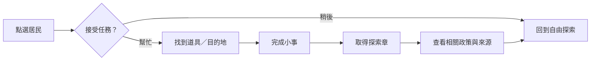

# 城市互動第一版規劃

狀態：規劃完成，遊戲尚未實作或上線。人物外觀與基礎動作另行更新；第一階段建議優先做「市民小任務＋城市探索護照」。

## 互動方向

讓使用者先在城市遇見一位居民，幫忙完成一件小事，再自然走進相關政策。第一次任務目標 30–60 秒可完成；每座城市初期 2–3 個任務，四城完整探索目標約 5–8 分鐘。這些是設計目標，實際效果需要上線後觀察。

角色沿用既有學童、長者、家長、旅客等 11 種身分，以大圓頭、柔色服裝、帽子及道具辨識。不使用候選人肖像作為遊戲角色。

## 第一階段：市民小任務

| 小故事 | 操作 | 帶到的內容 | 回饋 |
|---|---|---|---|
| 書包要送到哪裡？ | 點學童接任務 → 點書包 → 前往學校／教育區 → 交付 | 當前城市的教育／營養午餐政策 | 一枚教育探索章，學童揮手 |
| 陪長者找休息點 | 接任務 → 在附近選出休息點 → 陪同走到目的地 | 當前城市的長照／社福／醫療政策 | 一枚照顧探索章，角色坐下休息 |
| 旅客想認識城市 | 點旅客 → 從兩個附近地標選一個 → 抵達並查看介紹 | 當前城市的文化／觀光／交通主題 | 一枚城市探索章，旅客拍照 |

故事是導覽情境，不宣稱某項政策已落實或某個虛構設施真實存在。資料缺少對應主題時不硬塞任務，先採該城市有來源的內容。

### 一次任務的完整流程

1. 玩家主動開啟「市民任務」，畫面最多顯示 3 位可互動角色。
2. 點角色，出現一句需求與「幫忙／稍後」；不自動接任務。
3. 接受後出現小型任務卡：目前目標、單一步驟提示與「結束任務」。
4. 地圖只標示下一個目的地，短指引線連到實際場景；拖曳／旋轉仍可自由操作。
5. 點道具或目的地即可完成步驟，不要求精準拖放或快速連點；手機也可一手操作。
6. 完成後短暫顯示角色回應、探索章，以及「看看相關政策」；使用者可繼續逛或直接結束。
7. 點政策入口打開現有內容及來源；不用另造一套內容面板。

任務的「完成」只代表遊戲步驟完成。政策本身的政見／推動中／已完成分類照原資料呈現，不因遊戲操作改變。

## 第一階段：城市探索護照

- 每城 3 格探索章：教育、照顧、城市生活；實際任務依該市資料選取。
- 先點城市再開護照，可看目前城市／四城總覽，以及下一個可探索方向。
- 同一個任務重玩不重複增加章數。完成後不必強制分享或登入。
- 進度只保存在目前裝置，提供「清除探索紀錄」；先不做帳號、跨裝置排行或社群投票。
- 舊進度資料失效時可重新開始，不能讓地圖或政策頁無法使用。

## 第二階段候選玩法

| 玩法 | 帶來的體驗 | 優先順序 |
|---|---|---|
| 跟著居民散步 | 讓既有城市導覽有可跟隨的嚮導角色，每站停下說一句生活需求 | 高，沿用現有導覽與自動停止規則 |
| 城市找一找 | 找到指定地標／職業人物；每日可換一組，但不重做政策資料 | 中，先確保角色與標牌不互相遮擋 |
| 生活情境選擇 | 選「帶孩子出門／長者就醫／通勤」等情境，呈現有來源的政策入口 | 中，作為探索捷徑，不給政治立場分數 |

## 手機與桌機畫面

- 右上角工具增加一個「市民任務」入口；護照在任務面板內，避免工具選單持續變長。
- 手機：任務卡置於下方安全區上方，收合後只保留一行目標；角色提示不與政策標牌同時大量出現。
- 桌機：任務卡置於右側，避開上方工具與政策詳細面板。
- 任務期間也能開政策、切換縣市或回全景；離開任務城市時先收起任務，保留已取得的章。
- 相機只在接任務／按「帶我過去」時移動；使用者操作就停止自動運鏡。
- 開啟「減少動態效果」時保留全部操作，停止揮手、跳動與慶祝動畫。

## 與目前程式的接點

- `PEOPLE.list` 的 `role`、`activity`、`position`、`facing` 提供角色身分、即時座標及朝向。`characterKit` 保持七種身體批次與五種道具池，未新增大量獨立模型。
- 任務使用獨立狀態：`inactive → offered → active → completed / cancelled`；不借用政策的進度狀態。
- NPC 點擊僅在任務模式啟用，透過獨立透明拾取區放大觸控範圍，避免搶走建築／政策點擊。
- 任務進行中的居民暫停原路線、完成或取消後恢復；先限同時 1 個任務。
- 任務資料放在獨立檔案，引用現有城市／主題 ID，建置時檢查引用有效。
- 探索章採本機版本化進度；網站／NAS 更新不需遷移伺服器資料庫。

## 第一階段驗收

1. 首次訪客能在手機完成至少一個任務，並到達正確城市的政策與來源。
2. 接受、取消、重玩、跨市、回全景、重新整理皆有明確結果，不留下卡住的角色或鏡頭。
3. 一次最多 3 個角色提示、1 張任務卡，政策泡泡與主要工具保持可讀可點。
4. 探索章可保存、去重與清除；遊戲進度不改寫政策資料或政策完成狀態。
5. 桌機、320px 手機、深淺模式及減少動態模式都能完成相同步驟。
6. 保留現有角色批次，不讓所有居民都有常駐 DOM 提示；優先測量手機運行流暢度。

## 如何評估是否值得繼續

先觀察「任務啟動 → 任務完成 → 相關政策開啟／來源點擊」的轉換，再看探索第二座城市的比例。若要蒐集統計，另做不含身分的累積事件計數；現有 counter 只計頁面載入，不能據此推算停留時間或任務完成率。尚未新增事件蒐集。
